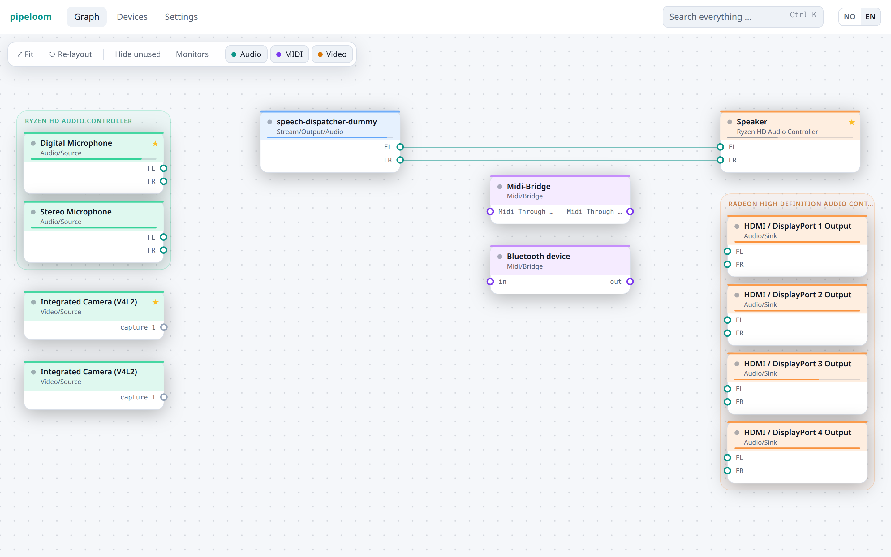
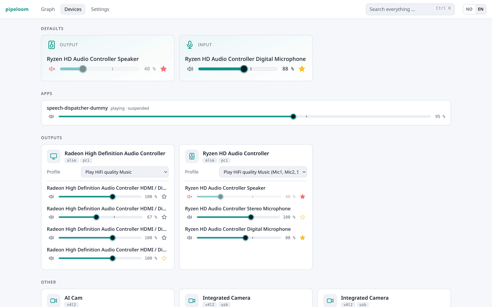
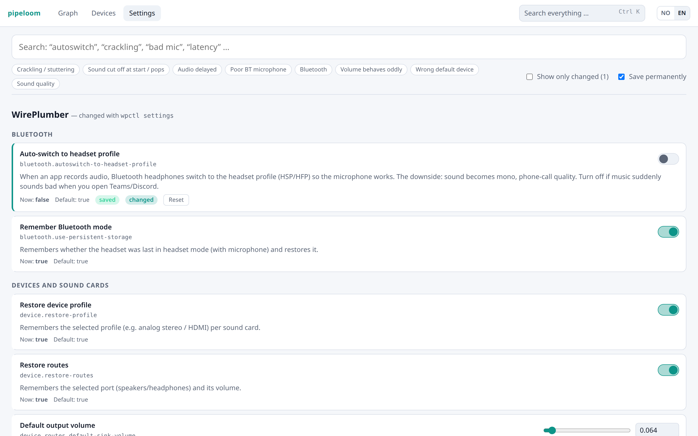

# pipeloom

A calm, good-looking desktop GUI for **PipeWire** and **WirePlumber** on Linux.

pipeloom shows your audio, MIDI and video graph as a tidy left-to-right signal flow. You can also
control devices, Bluetooth codecs and volumes, and find the settings you didn't know existed.
The UI is available in English and Norwegian.

> The project started out as *lydvev*, which is Norwegian for "sound weave".

<picture>
  <source media="(prefers-color-scheme: dark)" srcset="docs/graph-dark.png">
  
</picture>

## Features

- **Graph that untangles itself.** The graph is laid out with [ELK](https://www.eclipse.org/elk/)'s
  layered algorithm:
  - Sources and playing apps sit on the left, sinks and recording apps on the right, and filters in
    the middle.
  - Nodes from the same device or app are grouped.
  - App groups are reordered to follow the hardware they are wired to, so wires don't cross.
  - Wires are routed around the cards.
  - On wide screens, the columns spread out to use the space.

  You can drag cards and groups by hand (positions are remembered). Drag from port to port to
  connect, and click a wire to disconnect it.
- **Devices.** Pick profiles with readable names ("High quality – AAC", "Headset – mSBC") and choose
  ports and routes. Set volume and mute per device and per app, and set the default device. A star
  shows the current default, and a faded star means the device you picked is not available right now.
- **Settings.** Every WirePlumber setting (`wpctl settings`) is shown as a switch, slider or field,
  with its description, default value and saved state. You can also change PipeWire's runtime clock
  settings (`clock.force-quantum`, `clock.force-rate`, …).
- **Discoverability.** A curated catalog of useful options that can only be set in config files,
  with copy-paste snippets and the file path. Symptom search (*crackling*, *stutter*, *latency*,
  *bad headset mic*) leads you to the options that matter. Press **Ctrl+K** to search everything.
- **Inspector.** Click any node to see all its properties and what it is linked to.

<picture>
  <source media="(prefers-color-scheme: dark)" srcset="docs/devices-dark.png">
  
</picture>

<picture>
  <source media="(prefers-color-scheme: dark)" srcset="docs/settings-dark.png">
  
</picture>

The screenshots come from `scripts/screenshot/shoot.sh`. It records your PipeWire graph, anonymizes
it (user, host, machine id, MAC addresses, Bluetooth names), and renders the real UI in headless
Chrome.

## How it works

pipeloom talks to PipeWire using the standard command-line tools. It does not link to libpipewire.

- The Rust backend (Tauri 2) streams `pw-dump --monitor` and keeps a live copy of every object.
- Every change goes through `wpctl`, `pw-link`, `pw-metadata` or `pw-cli`. The backend passes
  arguments directly (no shell) and validates them first.
- The Svelte 5 frontend turns the raw objects into a model (`src/lib/model.ts`) and draws it.

## Requirements

- Linux with PipeWire ≥ 1.0 and WirePlumber ≥ 0.5. You need `pw-dump`, `pw-link`, `pw-metadata`,
  `pw-cli` and `wpctl` on your `PATH`.
- To build it, you also need Node.js ≥ 20, Rust (stable), and the Tauri system libraries (on
  Debian/Ubuntu):

  ```sh
  sudo apt install libwebkit2gtk-4.1-dev libsoup-3.0-dev libjavascriptcoregtk-4.1-dev librsvg2-dev
  ```

## Build and run

```sh
npm ci
npx tauri dev      # development, with hot reload
npx tauri build    # release build + .deb in src-tauri/target/release/bundle
```

## Tests

```sh
npx vitest run                                  # model, layout, catalog, search
npx svelte-check                                # types
cargo test --manifest-path src-tauri/Cargo.toml # pw-dump stream merging
cargo test --manifest-path src-tauri/Cargo.toml -- --ignored  # live smoke test against your PipeWire
```

The live smoke test only writes a temporary key that it then removes. It leaves your devices,
volumes and links alone.

## Contributing

Issues and pull requests are welcome. Corrections to the hidden-options catalog
(`src/lib/panels/catalog.ts`) are especially valuable, as are new translations.

## License

MIT, see [LICENSE](LICENSE).
